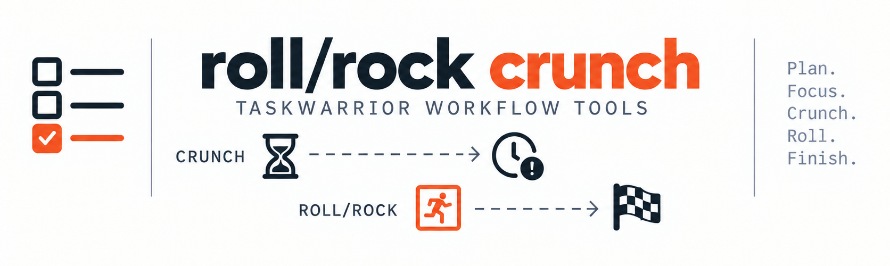

# Taskwarrior Roll/Rock + Crunch



Keep linked Taskwarrior tasks scheduled when plans change.

- **Roll** moves dependent due dates when earlier work moves or finishes.
- **Rock** plans backward from a fixed deadline.
- **Crunch** flags pressure from remaining work and due dates.
- **Phoenix** creates follow-up tasks after completion.

## Install

You need Taskwarrior, Python 3.10+, Git, and a POSIX shell (macOS, Linux, or WSL).
No extra Python packages are required.

**1. Clone and install.**

```sh
git clone https://github.com/ylub/tw-roll-crunch.git
cd tw-roll-crunch
sh ./install.sh
```

The installer refuses to overwrite existing files. Make sure `~/.local/bin`
is in your `PATH`.

**2. Connect the configuration.** Run this once from the cloned directory:

```sh
printf '\ninclude %s/config/taskrc.example\n' "$PWD" >> "$HOME/.taskrc"
```

Keep the clone at this location. For custom `TASKDATA` or `TASKRC`, use the
[full installation instructions](docs/setup-and-usage.md#install).

**3. Check the setup.**

```sh
task rc.hooks=0 show >/dev/null
task diagnostics
task roll help
```

Diagnostics should list the three Roll/Crunch hooks as active.

## Start here

Show your linked tasks:

```sh
task chain
```

| You want to… | Use |
|---|---|
| Build a flexible task chain | [Roll chain instructions](docs/setup-and-usage.md#roll) |
| Meet a fixed deadline | `task rock FINISH_ID` previews the plan |
| Inspect one chain | `task chain NUMBER` |
| Check workload pressure | `task TASK_ID info` shows the Crunch field |
| Repeat a task after completion | [Phoenix example](docs/setup-and-usage.md#repeat-with-phoenix) |

Replace `TASK_ID`, `FINISH_ID`, and `NUMBER` with your task or chain number.
Rock previews changes; add `--apply` only after checking the plan. Roll can
move linked due dates when you change or complete a predecessor.

## See it in action

A **finish-line** holds the final deadline. A **checkpoint** holds a date in
the middle of a chain.


[More screenshots: chain overview, Rock preview, and Crunch levels](docs/screenshots.md)

Fictional tasks, captured from release `2026.09.24.1` on Taskwarrior 3.5.0 and
rendered in a terminal-style view.
The Crunch screenshot uses a custom demo report.

## When you need more

- [Full setup, examples, upgrades, and uninstall](docs/setup-and-usage.md)
- [Calendar, days off, and half days](docs/setup-and-usage.md#days-off-and-half-days)
- [Roll and Rock field reference](docs/roll.md) · [Crunch scoring](docs/crunch.md)
- [Release notes](CHANGELOG.md) · [Run tests](docs/setup-and-usage.md#tests)

Created by [@ylub](https://github.com/ylub) with assistance from
[OpenAI Codex](https://openai.com/codex/). Independent of Taskwarrior and
Gothenburg Bit Factory. [MIT license](LICENSE).
