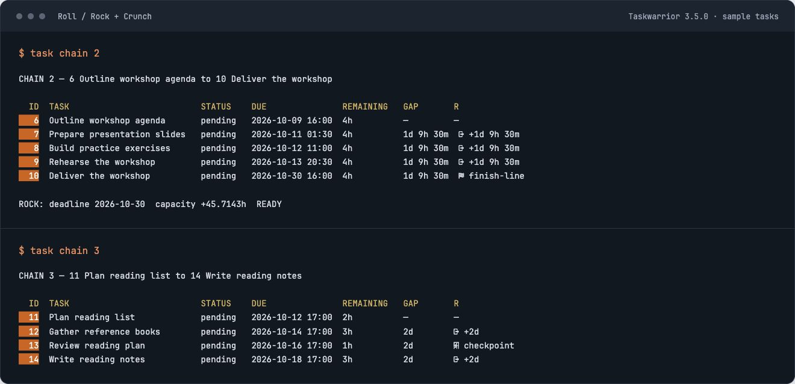
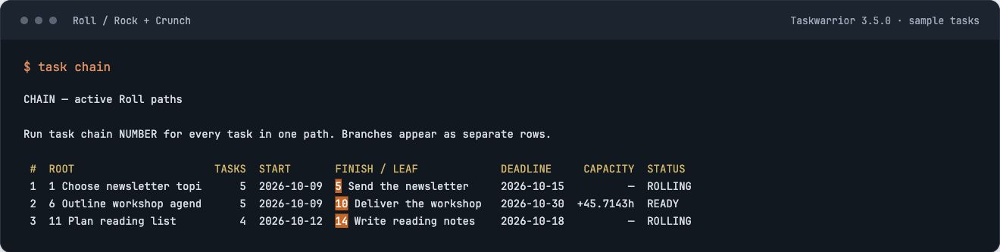
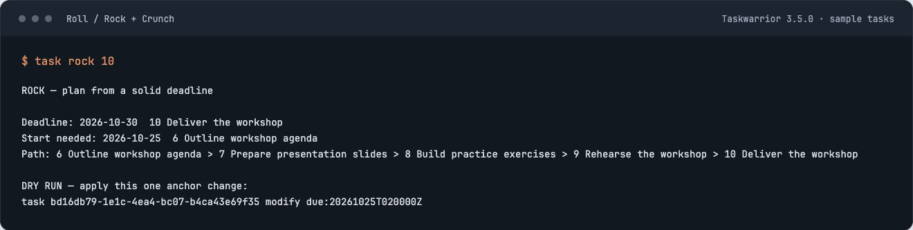
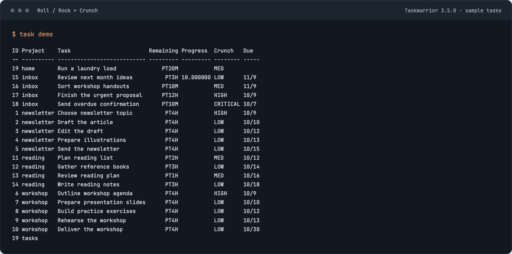

# Screenshots

[Back to the quick start](../README.md)

Fictional tasks from release `2026.09.24.1` on Taskwarrior 3.5.0, captured from
the demo and rendered in a terminal-style view.

## Finish-line and checkpoint

A finish-line holds the final deadline. A checkpoint holds an intermediate date.

## Chain overview

## Rock preview

## Crunch levels

This custom demo report shows remaining work, progress, due dates, and Crunch.

